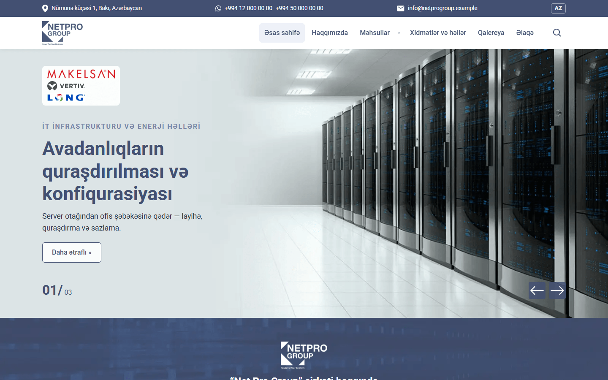

# Net Pro Group – IT & network equipment company website (full stack)

[](https://codelady-ship.github.io/net-pro-group-fiqma/)

A multi-page, responsive company website for **Net Pro Group**, a generic IT infrastructure, network and power equipment company. The project was **built from a Figma design** as a practice project: the company copy is written for the portfolio, and the address, phone numbers and e-mail are clearly marked sample data. Contact and product inquiries go to a **Node.js + Express + MongoDB API** (`backend/`, deployable to Render) with an admin workflow; without the API the forms fall back to `mailto:`.

> AZ: Figma dizaynı əsasında hazırlanmış təlim layihəsi — İT və şəbəkə avadanlıqları şirkəti üçün çoxsəhifəli, responsiv sayt. Əlaqə məlumatları nümunədir. Əlaqə və məhsul sorğuları Express + MongoDB API-yə yazılır (admin üçün status, qeyd, statistika); server əlçatan olmayanda forma e-poçt proqramını açır.



## Features

- 13 pages: home, about, 6 product categories, services, gallery, contact, site search and a custom 404 page.
- Home page hero slider, product carousel and scrollable gallery (vanilla JS, keyboard-accessible buttons).
- Products dropdown in the header; hamburger menu on mobile.
- Contact forms with validation. With the API online the inquiry is **saved in MongoDB** and the visitor gets a reference like `NPG-3F9A1C` (shown only when the API really returned one; otherwise the mail-app fallback runs); the product name from the "Broşür sorğusu" link is stored as the inquiry topic. Without the API (not configured, asleep or unreachable within 8 s) the form opens the visitor's mail app with a prepared message (`mailto:`).
- Spam protection: a hidden honeypot field (bots are stored as `spam` and hidden from the list) and rate limiting.
- Client-side site search over pages, products and services (`search-index.json`).
- Gallery lightbox built on the native `<dialog>` element.
- SEO: unique titles and descriptions, `lang="az"`, canonical URLs, Open Graph/Twitter tags, favicon, `robots.txt`, `sitemap.xml`, one `h1` per page, alt text on every image.
- Optimised images: photos converted to WebP; every asset path is ASCII without spaces.

Brand logos (Vertiv, Makelsan, Long and others) belong to their owners and are used only to reproduce the design.

## Tech stack

- **Frontend:** HTML5, CSS3 (Grid, Flexbox, media queries at 1100/960/720/520 px), vanilla JavaScript. No framework and no runtime dependencies.
- **Backend:** Node.js 20+, Express 5, MongoDB with Mongoose 8, zod validation (Azerbaijani error messages), JWT admin auth, CORS allow-list, rate limiting.
- **Tests:** `node:test` + supertest on an in-memory MongoDB.
- **Hosting:** GitHub Pages (site), Render free web service (API, `render.yaml`), MongoDB Atlas free cluster.

### REST API

| Method | Path | Access | Description |
|---|---|---|---|
| GET | `/api/health` | public | Status and database connection |
| POST | `/api/inquiries` | public (rate limited) | `{ name, email, phone?, message, topic?, page? }` → `201 { reference }`; `400` with field messages in Azerbaijani |
| POST | `/api/auth/login` | public (rate limited) | `{ email, password }` → `{ token }` |
| GET | `/api/admin/inquiries?status=new&q=ups&page=1` | admin | Paged list (50 per page), search, spam hidden unless `status=spam` |
| GET / PATCH / DELETE | `/api/admin/inquiries/:reference` | admin | Read; change status (`new`, `in_progress`, `closed`, `spam`) and/or add a note; delete |
| GET | `/api/admin/stats` | admin | Counts per status and the 10 most asked-about topics |

Admin calls need `Authorization: Bearer <token>`.

The shared header and footer are generated by a small Node script so all pages stay identical:

```bash
node tools/build-pages.js   # regenerates the *.html pages and search-index.json
```

## Run locally

```bash
git clone https://github.com/codelady-ship/net-pro-group-fiqma.git
cd net-pro-group-fiqma
npx serve .      # search needs a local server because it fetches search-index.json
```

API (needs MongoDB: a free Atlas cluster or a local `mongod`):

```bash
cd backend
cp .env.example .env   # fill MONGODB_URI, JWT_SECRET, ADMIN_EMAIL, ADMIN_PASSWORD
npm install
npm run dev            # http://localhost:4000
npm test               # API tests on an in-memory MongoDB
```

Then open a page with `?api=` (honoured only when the page runs on `localhost`/`127.0.0.1`, so a crafted link cannot redirect the live form), e.g. `http://localhost:3000/elaqe.html?api=http://localhost:4000`.

## Deployment

GitHub Pages serves the `main` branch from the repository root: https://codelady-ship.github.io/net-pro-group-fiqma/.
The old entry page `netprogroup.html` redirects to the root, and GitHub Pages uses `404.html` for unknown URLs.

API: create a free MongoDB Atlas M0 cluster (Network Access `0.0.0.0/0`), then on Render choose *New → Blueprint* and pick this repo. `render.yaml` creates the free web service `net-pro-group-api` from `backend/`; fill `MONGODB_URI`, `ADMIN_EMAIL` and `ADMIN_PASSWORD` (`JWT_SECRET` is generated). Put the Render URL into `NPG_API_URL` at the top of `main.js` and push to `main`. The free service sleeps after 15 idle minutes; if it does not wake up within 8 s, the form uses `mailto:` instead.

## What I learned

- Turning a fixed-width Figma layout into a fluid, responsive one with Grid and a few breakpoints instead of pixel margins.
- Keeping shared markup consistent across a static multi-page site with a tiny build script.
- Accessible navigation patterns: `aria-expanded`, `aria-current`, skip link, breadcrumbs.
- Handling forms without a backend using a validated `mailto:` flow, and later replacing it with a real API while keeping `mailto:` as the fallback.
- A small lead-management API: statuses, notes, search, a honeypot against bots and an aggregation for dashboard numbers.
- Why file names with spaces or Cyrillic characters cause broken links on the web.
